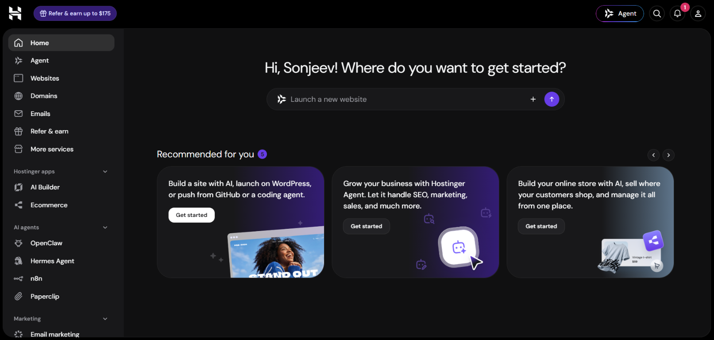
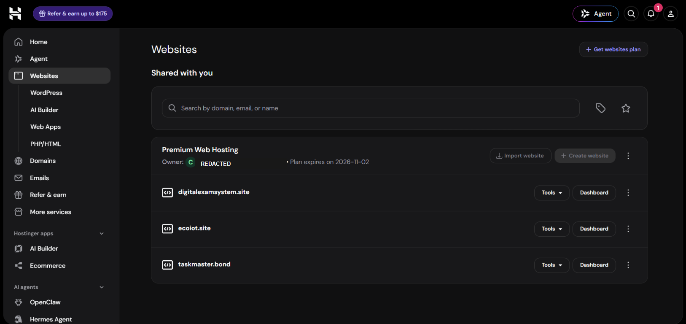
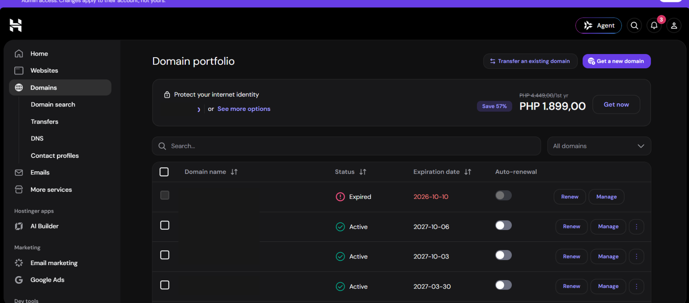
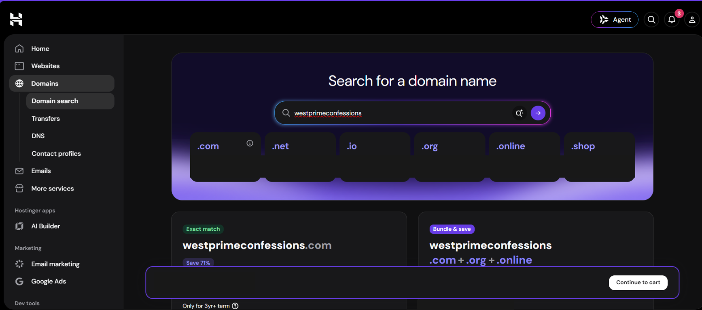

# Hostinger Deployment Guide and Project Log

This document records the Hostinger setup for WESTPRIME CONFESSIONS, the
deployment procedure followed, and the remaining checks needed for a capstone
demonstration. It distinguishes confirmed steps from items that still need a
fresh live-site check. Do not treat a checklist as proof of a test that has not
been performed.

- **Live site:** [https://westprimeconfessions.online/](https://westprimeconfessions.online/)
- **Domain registrar:** Hostinger (purchase reported by the owner)
- **Hosting provider:** Hostinger
- **Application:** PHP, MySQL, HTML, CSS, and JavaScript
- **Screenshots:** [`screenshot/`](./screenshot/)
- **Admin provisioning:** [`HOSTINGER-ADMIN-SETUP.md`](./HOSTINGER-ADMIN-SETUP.md)

> **Security:** Never put passwords, password hashes, SMTP secrets, recovery
> codes, private configuration contents, or private account details in this
> document, screenshots, source control, or a public report. Provide evaluator
> access separately through a secure channel. The private
> `wpc-private-config.php` belongs outside `public_html` and must never be
> uploaded into the public website directory.

## 1. Hostinger account and domain

### 1.1 Open hPanel

The saved screenshot shows the hPanel landing page and its main navigation,
including **Websites** and **Domains**. The deployment began by reviewing the
hosting account and its available website and domain controls. Collaborator
permissions can limit which controls are available; have the account owner
perform or authorize any blocked account-level task.

### 1.2 Review the websites list and available hosting

This historical screenshot shows websites on the shared hosting plan. The
owner's identifying details were redacted in the saved copy. The project was
not deployed to an arbitrary existing site: the owner later registered the
project's own domain and created a website for it. For a new deployment, use
the dashboard for the website explicitly assigned to the project and confirm
its document root before uploading application files.

### 1.3 Review domains and register the project domain

The domain portfolio is where domain ownership, DNS controls, and renewal
information can be reviewed. Unrelated domains are redacted in this screenshot.
The owner reported purchasing `westprimeconfessions.online` through Hostinger.

The search screenshot shows that `westprimeconfessions.online` was available
before checkout. It is historical evidence of the search, not proof of current
DNS configuration. Prices are intentionally omitted. The owner later reported
that the domain was purchased and the domain subscription was shown as active.

### 1.4 Create the website and attach the domain

The owner created a Hostinger PHP/HTML website for the project and reported
that Hostinger completed its website setup/migration. The live site is
`https://westprimeconfessions.online/`. In a fresh deployment:

1. In hPanel, open **Websites** and create or select the site assigned to this
   project.
2. Attach `westprimeconfessions.online` as the site's domain using Hostinger's
   site setup flow.
3. Open that site's **Dashboard** and **File Manager**.
4. Confirm the document root. In this deployment, the public web directory is
   `public_html`.
5. Confirm the domain points to this hosting site and wait for DNS propagation
   if Hostinger reports it is still in progress.

Do not guess A, AAAA, CNAME, or MX values. Record the DNS records actually
shown by Hostinger and configure MX only when setting up domain email.

## 2. Prepare the application before upload

1. Keep the source project in its repository and run the relevant local checks.
   The project was developed and tested locally with XAMPP at
   `http://localhost/wpc/`; do not deploy by opening local HTML files directly.
2. Review the files intended for production. Include the application code,
   required assets, schema, and runtime dependencies, but exclude Git metadata,
   local test artifacts, temporary files, and machine-specific configuration.
3. Keep the production database and SMTP configuration out of the package.
   The private `wpc-private-config.php` is created separately, outside the
   public web root.
4. Create a ZIP for upload. Before using it, inspect the archive contents and
   make sure it contains no private config, credentials, or database export
   containing user data.
5. Back up the current live files and database before replacing or migrating a
   production site.

The project has used a file named
`westprimeconfessions-hostinger-upload.zip` for application uploads. Its name
does not make it safe to extract over the live site without reviewing the
contents first.

## 3. Create and import the production database

The owner created a production MySQL database and database user in Hostinger,
then imported `backend/database/schema.sql` using Hostinger's database tools.
The production API subsequently returned JSON and student login worked, which
confirmed the application could connect to its database at that point.

For a new deployment, follow this sequence:

1. In hPanel, open **Databases** and create a MySQL database and a dedicated
   database user with only the permissions needed by this application.
2. Record the exact database host, database name, username, and password in a
   password manager or other private store. Do not put them in Git, screenshots,
   chat, or this guide.
3. Open the database in Hostinger's phpMyAdmin.
4. Import the reviewed `backend/database/schema.sql`.
5. If migrating existing data, take a private backup first and check for
   duplicate email addresses before applying the unique email constraint.
   Resolve duplicates deliberately; do not delete accounts just to make an
   import succeed.
6. Verify table creation and the import result in phpMyAdmin. Do not include
   user records, password hashes, or credentials in deployment evidence.
7. Configure the application to connect using the private production
   settings, then test the API and sign-in over the production HTTPS domain.

The schema does not seed an admin password. Create or update the admin
explicitly using the safe local hash-generation and SQL procedure in
[`HOSTINGER-ADMIN-SETUP.md`](./HOSTINGER-ADMIN-SETUP.md).

## 4. Configure secrets outside `public_html`

The application loads production database and mail settings through its
configuration helper. For this deployment, the owner created
`wpc-private-config.php` as a sibling of `public_html`, not inside it. The file
must return a PHP associative array containing the required configuration.
Use the current project code and README for the supported key names and exact
format.

1. In Hostinger File Manager, navigate to the account directory that contains
   `public_html`.
2. Create or edit `wpc-private-config.php` at that account level, alongside
   `public_html`, not inside `public_html` or any folder served by the website.
3. Add the production database values and, if enabled, the SMTP values to the
   returned PHP array.
4. Use the exact database host and mail server details provided by Hostinger.
   Do not substitute a guessed host, port, encryption mode, or another
   account's credentials.
5. Save the file and verify only that the application connects and expected
   mail features work. Never display, screenshot, paste, or share the file's
   contents while troubleshooting.
6. Restrict access to the Hostinger account and rotate any secret that has
   been exposed.

The application was initially unable to connect to the production database;
after the owner corrected the database host in the private configuration, the
API returned the signed-in user's JSON response and login worked. This
illustrates why the provider-supplied host must be copied exactly. Do not
include the actual database name, username, password, or private config
contents in the public deployment report.

## 5. Upload and deploy application files

### 5.1 Initial upload procedure

Use this sequence to install or replace the full application:

1. In Hostinger File Manager, go to the account level where `public_html` is
   visible.
2. Upload the reviewed application ZIP at that level, outside `public_html`.
3. Extract the ZIP into a new staging directory, also outside `public_html`.
   For example, use a clearly named folder such as `wpc-release-staging`.
4. Inspect the extracted directory structure and confirm the package does not
   include secrets or a replacement private configuration.
5. Back up the live site before replacing files.
6. Copy the application files from staging to the matching locations under
   `public_html`. Use **Copy**, not **Move**, if the staging copy should remain
   available as a rollback source.
7. Do not overwrite `wpc-private-config.php`, and do not copy a ZIP or staging
   folder into the public web root.
8. Open the live site and check the home page, login, API, CSS, JavaScript, and
   browser console for errors.
9. Keep the staging folder and ZIP until deployment is verified. After
   verification, remove only the specific staging folders and archive, and
   only after confirming they are outside `public_html`. Preserve
   `public_html` and `wpc-private-config.php`.

### 5.2 Small frontend update procedure

For a frontend-only update, do not extract the entire archive over the live
site. Extract it to a new staging directory outside `public_html`, then copy
only the changed files to their matching destinations:

| Staged source | Live destination |
|---|---|
| `frontend/confessions.html` | `public_html/frontend/` |
| `frontend/assets/css/style.css` | `public_html/frontend/assets/css/` |
| `frontend/assets/js/main.js` | `public_html/frontend/assets/js/` |

1. Copy the changed source file from staging; do not move it.
2. Choose the matching destination under `public_html`.
3. Confirm overwriting only that named application file.
4. Repeat for each changed file that is part of the release.
5. Hard-refresh the live page (`Ctrl+F5`) or use the page's cache-busting
   version query when provided by the updated HTML.
6. Test the changed behavior without creating unwanted public test content.

This careful file-by-file process was used for the confession composer
character counter: the page, stylesheet, and JavaScript were copied separately.
A later publish-button anti-duplicate change was packaged and extracted into
`wpc-publish-lock`; deployment of that specific change should be considered
complete only after the updated `confessions.html` and `main.js` have both been
copied to the live destinations and the live test below passes.

## 6. HTTPS, DNS, and server configuration

The owner reported that SSL was active in Hostinger. Before final submission,
verify the public behavior instead of relying on the dashboard status alone:

1. Open `https://westprimeconfessions.online/` in a signed-out browser and
   confirm the certificate is valid.
2. Open the corresponding `http://` URL and verify it redirects to HTTPS.
3. Check the browser developer console for mixed-content warnings.
4. In hPanel, record the actual DNS records and check their status/propagation.
   Include MX only if mail for the domain is in use.
5. Confirm `.htaccess` is present and active for this Apache deployment, and
   verify the site still loads after its security rules are applied.
6. Check that configuration files, SQL/schema files, vendor directories,
   screenshots, and documentation are not directly downloadable from the
   public site.
7. Do not record unverified HSTS, CSP, redirect, DNS, or access-control status
   as complete in a report.

The repository's `.htaccess` is intended to add security headers and block
access to sensitive paths. Confirm the exact headers and restrictions on the
deployed server; hosting configuration can differ from local XAMPP.

## 7. Email and password recovery

The owner created a domain mailbox and entered the provider's SMTP settings in
the private configuration. The mailbox address, SMTP hostname, port, username,
encryption setting, and password belong only in the private server
configuration; do not record their production values in this guide.

The forgot-password email flow was not confirmed as successfully tested in the
deployment history. Before claiming email recovery is working:

1. Confirm the mailbox exists and can send mail through the provider.
2. Confirm its SMTP host, port, username, sender address, and encryption in
   Hostinger's mail settings.
3. Keep the SMTP password in private config/environment settings only.
4. Submit a recovery request for an account whose mailbox you control.
5. Verify delivery and code expiry/single-use behavior without sharing a
   verification code or screenshot containing it.
6. If mail fails, review provider mail logs and application logs privately;
   redact addresses and all secret values before sharing diagnostics.

## 8. Admin account provisioning

The database schema intentionally does not create a default admin. Provision a
strong admin password using PHP locally, store it securely, and insert only its
hash in the database. Follow
[`HOSTINGER-ADMIN-SETUP.md`](./HOSTINGER-ADMIN-SETUP.md) for the full process.

The owner reported that admin setup and login worked. Before handoff, verify
that the admin can sign in, perform intended moderation tasks, sign out, and
recover the account through the configured email if that feature is enabled.
Do not include the admin password or its hash in screenshots or submission
materials.

## 9. Post-deployment verification

Run these checks on the production domain and record the date, browser/device,
and outcome in the capstone report:

| Check | Verification procedure | Known status |
|---|---|---|
| Site availability | Visit the live HTTPS URL in a signed-out browser. | The live site was reported deployed. Recheck immediately before presentation. |
| Database/API | Test login and the API without exposing configuration or server errors. | API returned authenticated-user JSON after the database host was corrected. |
| Student login | Sign in using an authorized test account and sign out. | Student login was reported working. |
| Admin login | Sign in as admin, confirm moderation, and sign out. | Admin login was reported working. |
| SSL | Validate the certificate and HTTP-to-HTTPS redirect. | Hostinger SSL was reported active; redirect still needs a direct check. |
| DNS | Record provider-assigned records and verify propagation. | Exact records and propagation evidence are not recorded here. |
| Confession posting | Submit one intentional test post, confirm it appears once, then remove it if not wanted. | Basic posting was tested during setup; retest after frontend updates. |
| Anonymous posting | Compare student feed author display with admin moderation view. | Feature was implemented; verify on production before claiming live status. |
| Character counter | Type letters, spaces, and punctuation; confirm live count and 1,000-character limit. | Frontend files were copied per the deployment steps; confirm on production. |
| Duplicate-submit guard | Submit once and rapidly activate publish again; confirm only one entry appears. | Code was locally tested; production deployment and verification are pending unless separately confirmed. |
| Password recovery | Request and use an email code; verify expiry and single-use behavior. | SMTP configured; successful end-to-end mail test is not recorded. |
| Responsive layout | Test mobile, tablet, and desktop widths in more than one browser. | Needs a fresh production test record. |
| Error handling | Try an invalid route and invalid form input; confirm no PHP/SQL details are shown. | Needs a fresh production test record. |
| Performance | Measure page load under normal network conditions and note the tool/browser. | No measured production timing is recorded. |
| Secrets and access | Confirm private config is outside the document root; remove temporary staging/archive after verification. | Private config was placed outside `public_html`; review file manager before handoff. |

Avoid leaving public test confessions in the production feed. Do not test spam
protection by repeatedly creating real posts; use a browser/network test or
remove authorized test entries immediately after verification.

## 10. Deployment evidence and screenshots

The [`screenshot/`](./screenshot/) folder currently contains four saved,
redacted Hostinger screenshots:

1. `01-hostinger-hpanel-home.png` - hPanel home.
2. `02-hostinger-shared-websites.png` - website list, with owner details
   redacted.
3. `03-hostinger-domain-portfolio.png` - domain portfolio, with unrelated
   domain names redacted.
4. `04-hostinger-domain-search-results.png` - search results before purchase;
   pricing is omitted.

These screenshots document the initial account/domain steps only. They do not
show or prove database imports, private settings, live login, SSL redirects,
email delivery, or final performance. Capture additional screenshots for the
deployment report only after performing those steps. Before saving each image:

- crop or redact passwords, hashes, email verification codes, personal/account
  identifiers, database names/users, and private file contents;
- never capture the contents of `wpc-private-config.php`;
- never show phpMyAdmin rows containing passwords/hashes or personal student
  data;
- avoid exposing evaluator/demo passwords; and
- do not include domain prices unless the instructor explicitly requires them.

## 11. Deployment report and capstone checklist

The course rubric requests a live URL, registrar and hosting details,
step-by-step deployment report with screenshots, read-only/demo access where
applicable, and a source repository link. The project README includes the
rubric, project setup, features, stack, and links. Prepare a separate PDF report
with verified evidence and a reflection written in your own words.

| Report item | Evidence to include | Status |
|---|---|---|
| Live URL | `https://westprimeconfessions.online/`, opened in a signed-out browser. | URL known; recheck availability before submission. |
| Domain and registrar | Domain name and Hostinger domain account status; omit purchase price. | Purchase reported; confirm current portfolio/renewal details. |
| Hosting provider | Hostinger plan and PHP version from hPanel. | Provider known; record exact plan/runtime from hPanel. |
| Deployment steps | This guide plus screenshots of upload, extraction, and file placement. | Four initial account/domain screenshots exist; add redacted deployment screenshots if available. |
| DNS | Actual DNS record values/status and propagation check. | Not documented; record from hPanel. |
| SSL/HTTPS | Certificate, redirect, and mixed-content evidence. | SSL reported active; verify redirect and browser warnings. |
| Database | Import/connection evidence without secrets, user data, or hashes. | Import and live connection reported working. |
| Security | Explain private config, password hashing, prepared statements, validation, CSRF, sessions, and headers. | Describe only measures verified on the deployed version. |
| Functionality | Login, recovery, posting, anonymity, character counter, duplicate protection, and moderation results. | Some features reported working; complete the production checks above. |
| Responsiveness/performance | Device/browser sizes and measured timing. | Collect before submission. |
| Error handling | Safe invalid-route/form behavior without PHP/SQL details. | Test and capture redacted evidence. |
| Evaluator access | Approved demo account and instructions, provided securely. | Arrange separately; never put credentials in this file or Git. |
| Reflection | Challenges, solutions, lessons learned, and future improvements. | Write for the report. |
| Repository | [github.com/Jandyllee/wpc](https://github.com/Jandyllee/wpc) and the project README. | Repository URL known. |

Do not create unused DNS records merely to match rubric wording. Report only
records and features that are actually configured and tested. Do not include
private credentials, domain prices, or unredacted account screenshots.
